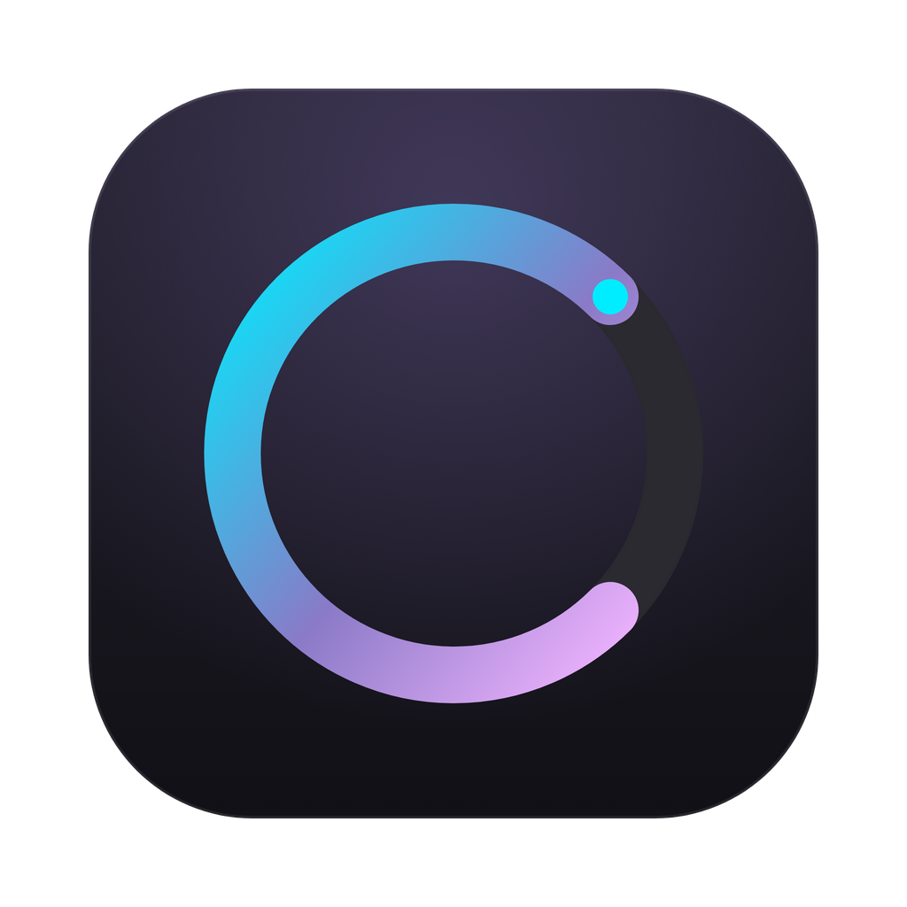
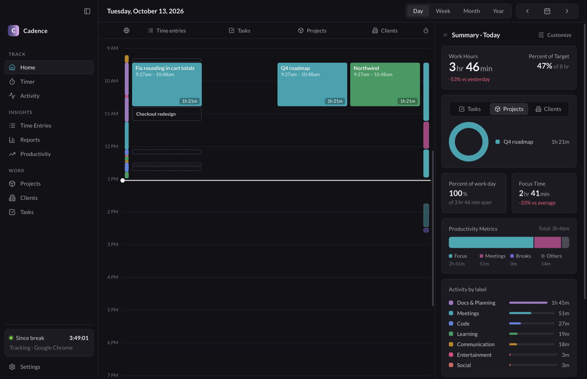
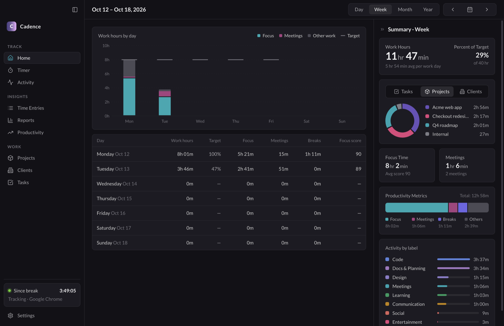
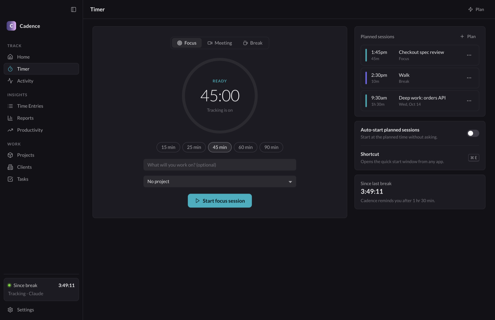
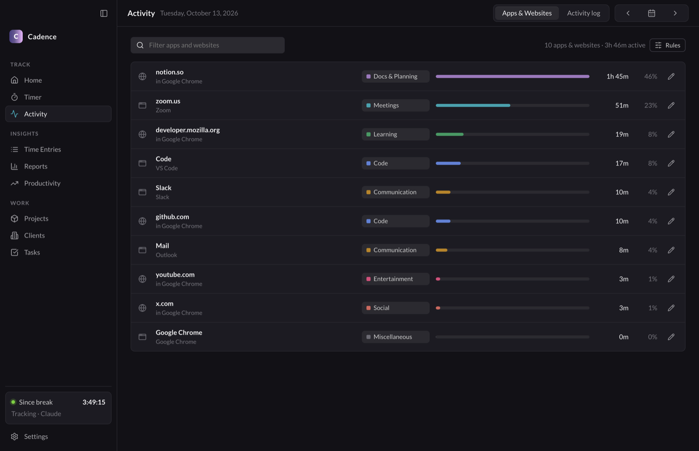
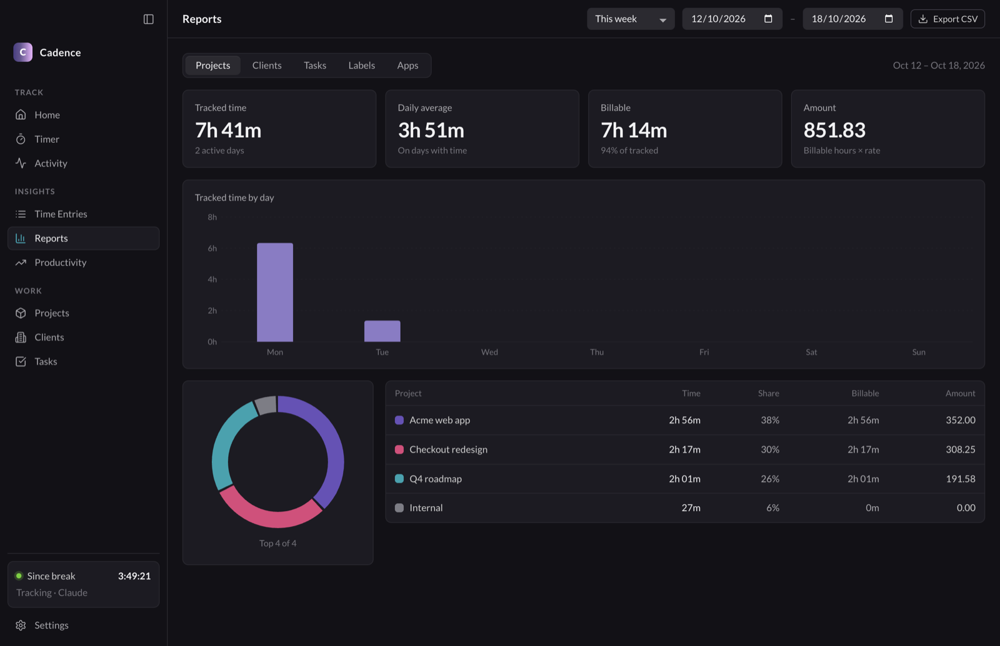
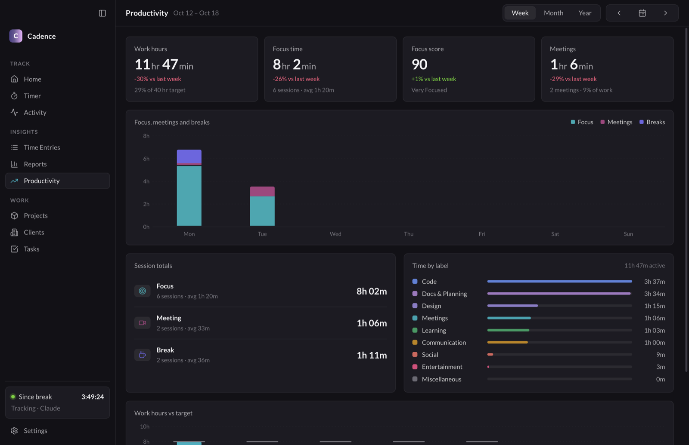
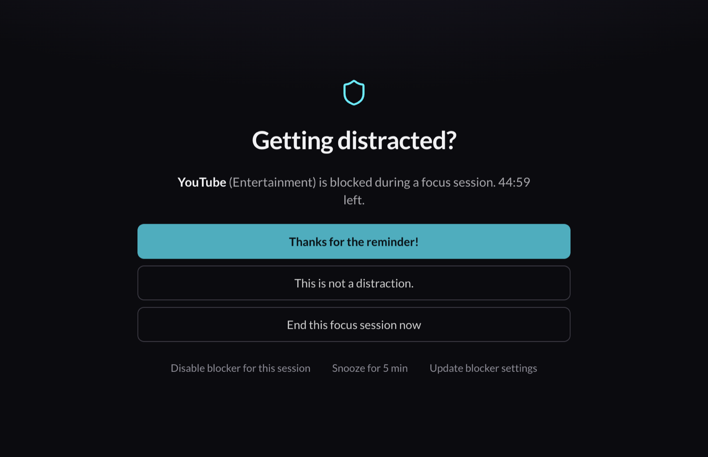
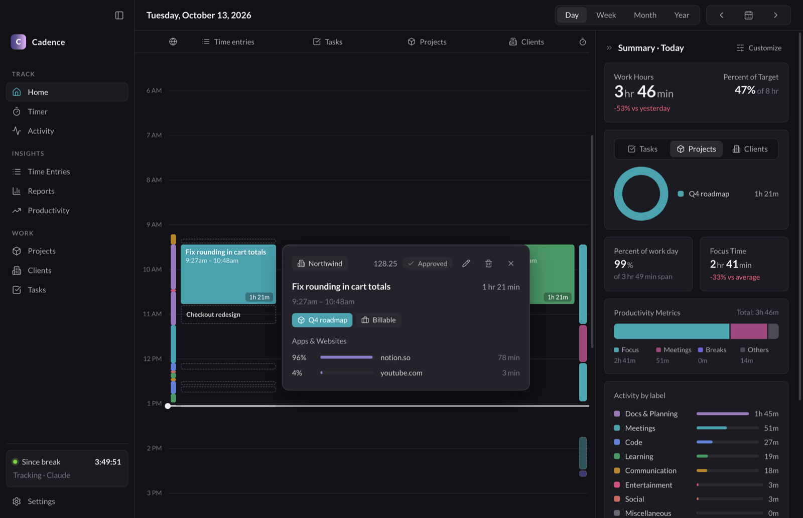

<p align="center"></p>

<h1 align="center">Cadence</h1>

<p align="center">A local-first automatic time tracker for macOS.<br>No account. No server. Your data stays on your Mac.</p>

<p align="center">
<a href="https://github.com/SuzalShrestha/cadence/actions/workflows/ci.yml"></a>
<a href="https://github.com/SuzalShrestha/cadence/releases/latest"></a>
<a href="https://scorecard.dev/viewer/?uri=github.com/SuzalShrestha/cadence"></a>
<a href="https://www.conventionalcommits.org"></a>
</p>

<p align="center"><a href="https://suzalshrestha.github.io/cadence/"><b>Website</b></a> · <a href="https://github.com/SuzalShrestha/cadence/releases/latest"><b>Download</b></a> · <a href="CHANGELOG.md"><b>Changelog</b></a></p>

<p align="center"></p>

Cadence records the app and website you use, puts the time on a calendar, and helps you focus with sessions, a blocker and break reminders. Its tracking behavior and visual style come from a study of the Rize desktop app ([docs/findings.md](docs/findings.md)).

> [!NOTE]
> Cadence is an independent open-source project. It is not affiliated with, endorsed by or connected to Rize. Rize is a trademark of its owner. Cadence has no Rize code, logos or icons, and it does not connect to Rize servers.

## Install

1. Download the newest `.dmg` from [Releases](https://github.com/SuzalShrestha/cadence/releases):
   - Apple Silicon (M1 or newer): [`Cadence-arm64.dmg`](https://github.com/SuzalShrestha/cadence/releases/latest/download/Cadence-arm64.dmg)
   - Intel: [`Cadence-x64.dmg`](https://github.com/SuzalShrestha/cadence/releases/latest/download/Cadence-x64.dmg)
2. Open the dmg and drag **Cadence** to **Applications**.
3. The app is not signed with an Apple Developer ID, so macOS blocks the first launch. Do one of these:
   - In Finder, right-click **Cadence** and select **Open**. Then select **Open** again. On newer macOS, go to **System Settings → Privacy & Security** and click **Open Anyway**.
   - Or run this command one time:
     ```bash
     xattr -dr com.apple.quarantine /Applications/Cadence.app
     ```

## Updates

Cadence updates itself. It checks GitHub Releases on launch and every 6 hours, downloads a new version in the background, and installs it when you restart or quit. Settings → General → Updates shows the version and what is new, and has **Check now**. You can turn off automatic checks there.

Releases are signed with the Cadence certificate (SHA-1 `B875E6B5…4FE32D`), so an update keeps your macOS permissions. To check a download:

```bash
gh attestation verify Cadence-arm64.dmg --repo SuzalShrestha/cadence
```

Version 0.2.x has no updater. Install the next release by hand one time; after that, updates are automatic.

macOS asks for these permissions on the first run:

- **Automation → System Events**: gives the frontmost app name.
- **Accessibility**: gives window titles.
- **Automation → your browser**: gives the URL of the current tab (Safari, Chrome, Brave, Edge, Arc, Vivaldi).

## Screenshots

| | |
|---|---|
|  |  |
|  |  |
|  |  |
|  |  |

## Features

**Tracking**
- Records the frontmost app, window title and browser URL every 15 s. Idle after 30 s / 5 min, like Rize.
- Labels from regex rules (Settings → Apps & Websites, or the pencil on the Activity page). Per-rule flags: counts as focus or meeting, detect idle, block in focus / meetings / breaks, always block, track titles, track full URLs, don't track.
- Global privacy: strip titles, host-only URLs, no URLs.

**Home**
- Day calendar with lanes for activity, time entries, tasks, projects, clients and sessions, and a now-line.
- Drag on a lane to add a time entry or a session. Click a block for its details, apps and websites, edit and delete.
- Suggested entries (dashed) from project, client and task keywords, with Accept and Dismiss. "Tracking…" marks untagged work in progress.
- Week, Month and Year views with work hours against target.
- Summary column: work hours vs yesterday, percent of target, Tasks/Projects/Clients breakdown, percent of work day, focus time vs average, productivity metrics, time by label, top apps. Mark a day as PTO.

**Sessions**
- Focus, meeting and break sessions with a countdown ring, extend and end. Automatic focus, meeting and break detection from activity.
- Planned sessions, Pomodoro sets (4 × 25/5, 20 min long break), auto-start, reminders before start, and break reminders.
- Distraction blocker window with Rize's choices, snooze, and urge surfing (10 s lock). Full-screen break window.
- Focus score (0–100) with a summary card and a 1–5 rating after each focus session. A card when you reach your daily target.

**Other windows**
- Desktop widget (top right): session or "since break" timer, work hours and percent of target. Right-click for controls.
- Quick start window: `Cmd+E` from any app.
- Menu-bar timer and menu.

**Insights and work**
- Activity: apps and websites with window titles, and the full activity log.
- Time Entries: week list, billable flag, accept suggestions.
- Reports: group by project, client, task, label or app; any date range; CSV export.
- Productivity: weekly, monthly and yearly focus, meetings, breaks, focus score and target.
- Weekly Report: the sections of Rize's weekly assessment, computed on your Mac, with a coach recommendation and Save PDF. A notification on Monday.
- Projects, Clients, Tasks: colors, rates, budgets, keywords, archive and done.

**Settings**: theme (dark, light, system), 24-hour clock, session lengths, blocker, work-hour targets for each weekday, shortcut, widget.

## Privacy

- Cadence makes one kind of network request: the update check to GitHub Releases (Settings → General → Updates can turn it off). There is no account, telemetry or analytics.
- Settings → Tracking & Privacy can strip window titles, keep only the host of URLs, or record no URLs.
- A rule can turn off tracking for one app or website.

## Data

Data is in `~/Library/Application Support/Cadence/`:

- `events/YYYY-MM-DD.jsonl`: recorded activity, one file per day
- `db.json`: clients, projects, tasks, time entries, sessions, planned sessions, PTO days
- `settings.json`, `rules.json`

Set `CADENCE_DATA=<folder>` to use another folder.

## Build from source

Requires Node.js 22 or newer and macOS.

```bash
npm install        # also installs the Git hooks
npm start          # run in development
npm run check      # Biome lint and unit tests
npm run smoke      # render check (set SMOKE_DIR to keep the screenshots)
npm run dist       # build dist/*.dmg and dist/*.zip
```

A local build is signed ad hoc unless `CADENCE_SIGN_P12` and `CADENCE_SIGN_PASSWORD` are set (see [CONTRIBUTING.md](CONTRIBUTING.md#signing)). An ad hoc build runs, but it cannot update itself and macOS asks again for permissions after each new build.

The render check opens every page and window, saves screenshots, prints renderer errors and exits 1 if there are any. It shows the full-screen overlays for a few seconds.

## Contributing

See [CONTRIBUTING.md](CONTRIBUTING.md). Report security problems as told in [SECURITY.md](SECURITY.md).

## License

[MIT](LICENSE). Third-party parts (Lato font, Lucide icons, Electron) keep their own licenses. See [THIRD_PARTY_NOTICES.md](THIRD_PARTY_NOTICES.md).
